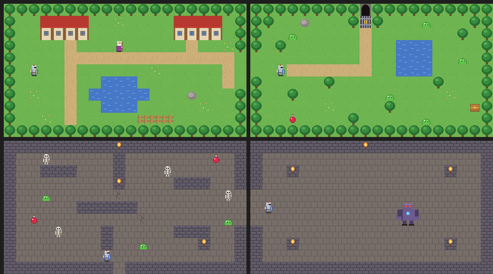

# gm_crystal_quest

A small top-down action RPG made in GameMaker / GML, for teaching children.

Monsters stole the village crystal. Find the key in the forest, open the dungeon, beat the guardian and bring the crystal back.

## How to play

| Key | Action |
|-----|--------|
| Arrow keys | walk |
| `Space` | swing the sword |
| `H` | drink a potion (+2 hearts) |
| Mouse | choose your hero at the start |

- **Knight**: 6 hearts, damage 2, slow. **Ranger**: 4 hearts, damage 1, fast.
- Every 5 XP you level up: +1 heart and +1 damage. Slimes give 1 XP, skeletons 2, the guardian 10.
- The villager heals you. If you lose all hearts you faint and wake up in the village — you keep XP, level, potions and the key.
- Beat the guardian and touch the crystal to win.

Always start the game from the first room (`rm_Choose`) — `o_Game` lives there.

## How it works

| Object | What it does |
|--------|--------------|
| `o_Game` | **Persistent**: lives through all rooms. Hero stats, XP, level, potions, key, messages (`Say()`), HUD, fainting. |
| `o_HeroCard` | One hero on the choose screen. Its stats are Variable Definitions set in the room editor. |
| `o_Hero` | Walks with `move_and_collide(dx, dy, walls)` — `walls` is the **Walls tile layer**, so everything painted there blocks. Space creates `o_Sword`. `Hurt()`. |
| `o_EnemyBase` | Parent of `o_Slime`, `o_Skeleton`, `o_Guardian`: chases the hero when close, otherwise wanders. `hp`, `move_speed`, `damage`, `xp`, `sight` are Variable Definitions that the children change. |
| `o_RoomExit` | Invisible. `target_room`, `target_x`, `target_y` tell where the hero goes. |
| `o_Villager`, `o_Potion`, `o_Chest`, `o_LockedDoor`, `o_Crystal` | The world. |

Every room has two tile layers made with the tileset `ts_World`: **Ground** (grass, path, floor) and **Walls** (trees, water, houses, dungeon walls).
To build a room: paint the ground, paint the walls, place the objects.

## Lessons example

With 1.5 hours per lesson.

1. Project, tileset and the two tile layers, paint the village. `o_Hero` walks with `move_and_collide` against the `Walls` layer.
2. `o_Game` (persistent), the forest room, `o_RoomExit` with `target_room` / `target_x` / `target_y`.
3. The sword (`o_Sword`), `o_EnemyBase` with HP, chasing and wandering, `o_Slime` as its child.
4. Getting hurt, invincibility, hearts in the HUD, fainting and waking up in the village.
5. XP and level up, potions, the chest with the key, the locked door, the villager and messages. Sounds.
6. The choose screen with two heroes, the skeleton, the guardian, the crystal and the win screen.

## Assets

- Graphics: own pixel art (tileset and sprites), drawn by `tools/make_art.py` (Python + Pillow). Free to use.
- Sounds: made with sfxr (https://sfxr.me, public domain), generated by `tools/make_sfx.js`
  (`npm install jsfxr`, then `node make_sfx.js <output folder>`).
- Fonts: Bernard MT Condensed, the same as in Farm Builder.
